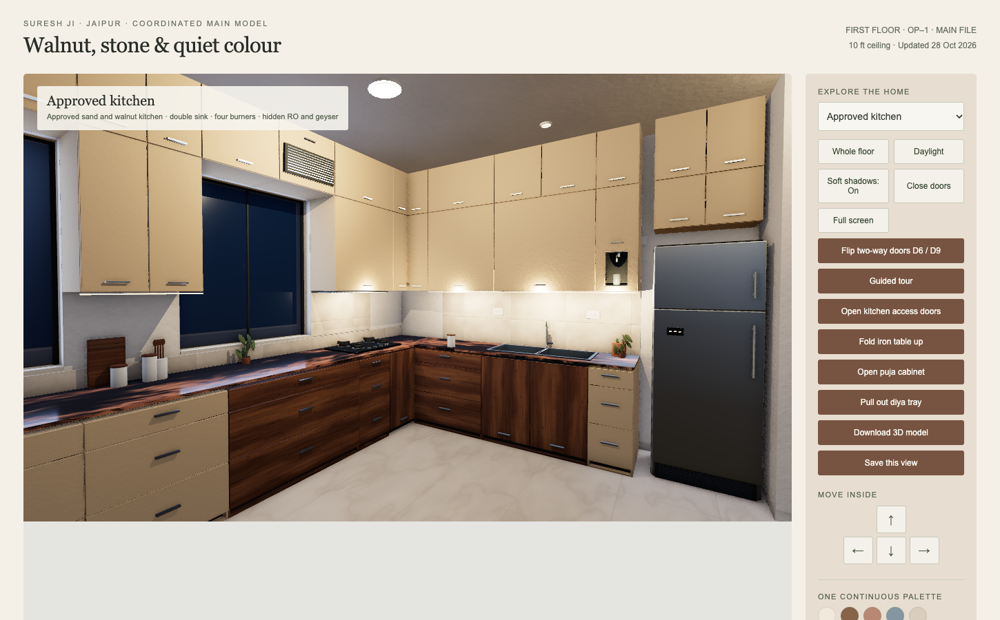
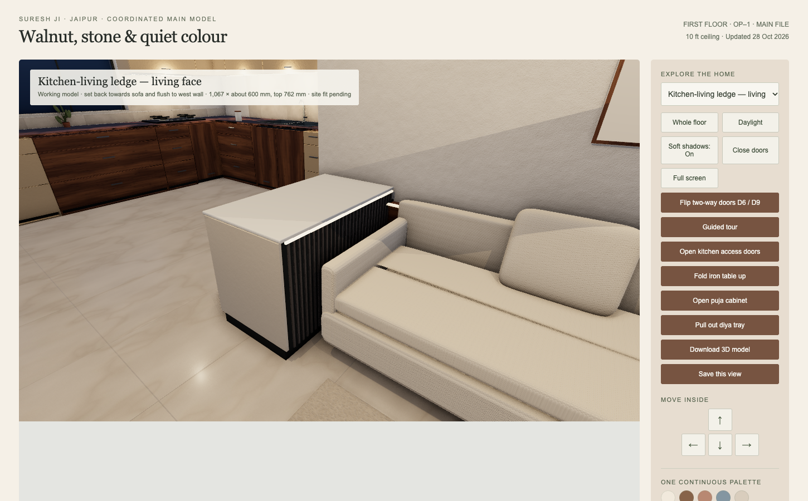

# Jaipur Home — first-floor 3D model

This private repository tracks one maintained first-floor interior model for the Jaipur home. Git commits record model and documentation changes; the architect layout and site measurements govern construction decisions.

## Open the model

1. Download or clone the repository.
2. Open [the standalone walkthrough](output/jaipur-home/walkthrough.html) locally in a modern desktop browser. It works offline and has room views, walking controls, daylight/evening lighting and a GLB download button.
3. For a static 3D file, use [jaipur-first-floor.glb](output/jaipur-home/model/jaipur-first-floor.glb). The walkthrough contains the interactive door and puja controls; the GLB is a static scene.

GitHub shows the walkthrough as a file. Download it to run the interactive viewer.

## Current model

- The kitchen–living storage ledge (`R-019`) sits back near the sofa, meets the west wall, and has kitchen-facing drawers. Its model dimensions are about 1,067 × 600 mm with a 762 mm top; site fit and joinery details remain to be checked.
- Both kitchen worktop runs show the client's black-and-copper granite **under consideration** (`R-020`). The [site photo](output/jaipur-home/kitchen-granite-reference.jpg) is the reference; the rendered pattern is an approximation, not a final slab selection. Other granite in the house is unchanged.
- The architect-traced walls, openings, columns, shafts and 10 ft model ceiling remain in place.

Read the [model notes](output/jaipur-home/README.md), [change log](output/jaipur-home/CHANGELOG.md) and [project handoff](docs/PROJECT_HANDOFF.md) for design context and outstanding checks.

## Editing

The editable scene is [model/interior.js](output/jaipur-home/model/interior.js), with material generation in [model/realism.js](output/jaipur-home/model/realism.js) and baked textures in `model/textures-baked.js`. Run `python3 build_walkthrough.py` after changing source files. Update the checked-in GLB when geometry or materials change, run focused checks, and commit the model, outputs and documentation together.

This is a visual coordination model. Verify finished dimensions, stone slab and fabrication details, structure, services and approvals with the relevant site team before execution.
